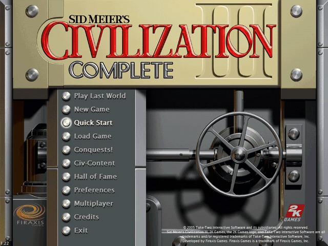
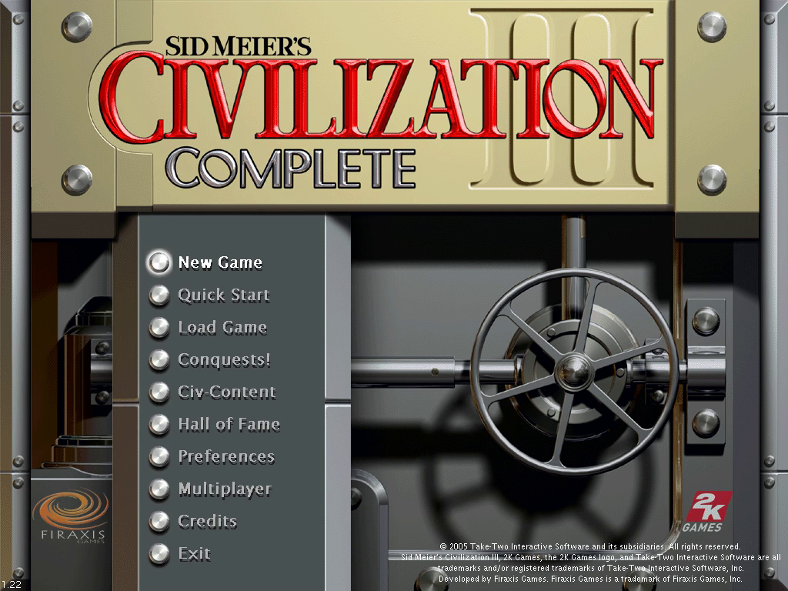
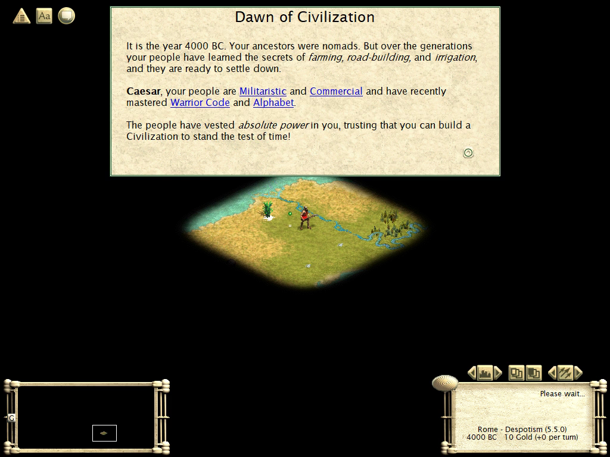
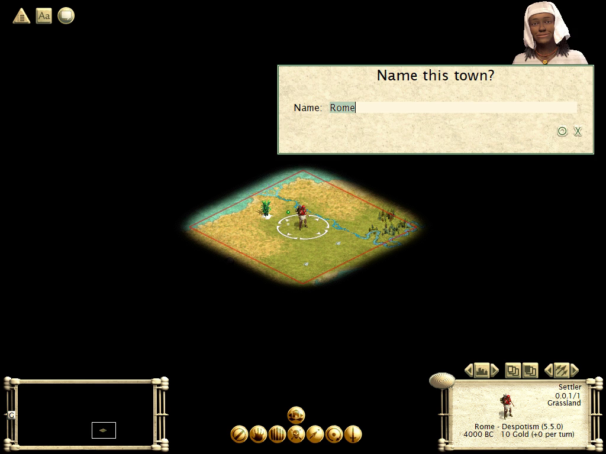
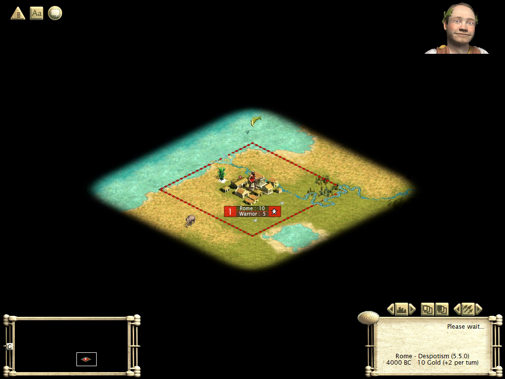
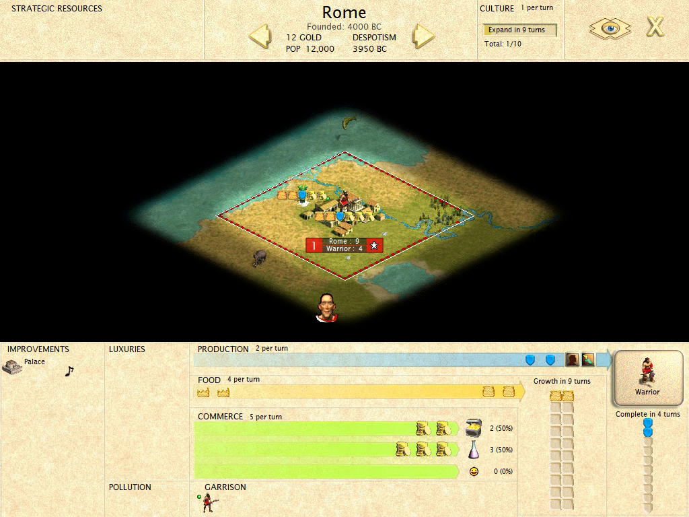

# Civilization III: Conquests — Static Recompilation

A static recompilation of **Sid Meier's Civilization III: Conquests**
(Firaxis, 2003; the 2015 Steam "Complete" build) from the shipping Win32
executable to C, compiled fresh and run natively on modern Windows, and on
Linux as a native program with no Wine: the first Linux Civilization III
([Linux, native](#linux-native)).



*The recompiled game, recorded with `--headless --record` and a scripted
mouse and keyboard: main menu, Quick Start, found Rome, end the first turn.
Sped up 5x.*

Built on the [pcrecomp](https://github.com/sp00nznet/pcrecomp) toolchain and
following its shared house style (layout, CLI, harness, headless mode). It sits
next to [civ](https://github.com/sp00nznet/civ) (the 1991 original) and
civ2 in the same collection.

**This is an unofficial fan project, not affiliated with Firaxis Games or
Take-Two Interactive.** No game files are in this repository, and neither is
the generated C: you supply your own copy and the pipeline builds everything
locally.

## Status: v0.1.0-dev, alpha. The whole game is lifted, boots, and plays, and it plays the same game as the original: the same state, turn after turn.

| Stage | State |
|---|---|
| P0: pick the build | done: Steam `Civ3Conquests.exe`, VC6, no DRM ([RECON.md](docs/RECON.md)) |
| Function catalog (`disasm32`, vtable seeds) | 15,308 functions, 95.2% of `.text`, about 10 minutes |
| Lift (`run_lift.py --all`) | **15,929 functions, 6.3M lines of C, 0 lift errors**, 0 not-lifted stubs |
| Host (`build/civ3.exe`, 32-bit, pcrecomp `native32`) | **plays**: CRT, WinMain, Steam init, jgl.dll renderer, sound.dll, main menu, a new game, the first turn and the AI's turn ([host.md](docs/host.md), [bringup.md](docs/bringup.md)) |
| Headless mode | `--headless --record out.mp4`: hidden window, jgl's GDI blits mirrored to ffmpeg. Works over RDP |
| Scripted input | `--move`, `--click`, `--key`: mouse and keyboard as posted window messages |
| Conformance harness | `tools/conformance.py`: **7/7 milestones**, through a scripted Quick Start into a game; lift health; fails on regression |
| Differential test | `tools/oracle.py`: the same host runs the original machine code (`--original`) next to the lifted C from one save. **The same game state every turn for 19 turns** (3900 to 2950 BC, the AI moving every civ) ([testing.md](docs/testing.md)) |
| Native Linux (`build-linux/civ3`, pcrecomp `win32hle`) | **plays**: the intro movie, the main menu, music and sound, Quick Start into a game and 60 turns on the autopilot, in a window or headless; jgl.dll and sound.dll lifted too ([linux.md](docs/linux.md)) |
| Play tests | `tools/playtest.py`: 100 scripted cases with pass/fail verdicts: every main-menu item and the way back, every in-game screen by hotkey and button followed by 5 turns, New Game as all 31 civs, all 12 Conquests scenarios ([testing.md](docs/testing.md)) |

### Compatibility

| Mode | State |
|---|---|
| Main menu | works: every item opens its screen, and Esc comes back. An item takes one click or two, depending on whether the menu took the hover first |
| New Game (all 31 civilizations), Quick Start, Load Game, Conquests! scenarios (all 12) | work (scripted headless runs, each played on by the autopilot) |
| In game: advisors F1-F11, Save, Load, Preferences, Civilopedia, Government, Retire, Quit, New Game, the menu buttons | work: each screen opens, closes, and the game plays 5 more turns |
| Same game as the original | yes: the lifted build and the original machine code reach the same game state every turn (`tools/oracle.py`) |
| Higher resolutions | 1280x1024 works (`KeepRes=1` and `Video Mode=1280` in `conquests.ini`, below; the presenter's F10 menu sets them). The desktop's own size (`KeepRes=1` alone) needs a host fix that is written but untested |
| Intro and wonder movies (Bink) | play, in the presenter and headless: the host keeps Bink's picture in memory and shows or records it, so Bink's own DirectDraw output (which faulted headless over RDP) is not used. `--classic` plays them as the game did |
| The presenter | the game in its own Direct3D 11 window: resizable, borderless fullscreen (F11), sharp scaling (F12), settings (F10) including the game's resolution. Its input path is tested (Esc through the intro, a click into Quick Start); played at the console, not yet |
| Linux, native | plays: intro, menus, music, Quick Start, turns; text pixel-close to Windows. Not on Linux yet: `--original`, the play-test suite, multiplayer ([linux.md](docs/linux.md)) |
| Multiplayer, force feedback | not tested |

### Resolution

The game reads its display size from `game\Conquests\conquests.ini` at start
(`sub_005786F0`), with two keys most players never saw:

| `KeepRes` | `Video Mode` | The game runs at |
|---|---|---|
| 0 or absent | ignored | 1024x768 |
| 1 | 1600 / 1280 / 1152 / other | 1600x1200 / 1280x1024 / 1152x864 / 1024x768 |
| 1 | absent or 0 | the desktop's size, from 1024x768 up to 8192x8192 |

The map takes the whole screen and the interface sits in its corners; full-screen
art like the main menu is centred. The same startup code also reads
`QuickStart`, `NoSound`, `Refresh`, `NoForceFeedback`, `NoAIPatrol` and
`Yumbo` (compared against 907: a developer switch, not yet explored).

## Screenshots

Rendered by the recompiled executable and recorded headlessly
(`--headless --record`) over RDP. Main menu, then a scripted Quick Start:



| | |
|---|---|
|  |  |

| | |
|---|---|
|  |  |

## Getting Started

You need **your own copy of Civilization III Complete** (Steam app 3910). Only
the Steam build is supported: the retail discs' executables are different
builds. Nothing from the game is in this repository and nothing is downloaded
for you.

### Quick start

1. Download this repository (the green **Code** button, then **Download ZIP**)
   and unzip it somewhere with 4 GB free.
2. Install **Visual Studio 2022 Build Tools** with *Desktop development with
   C++* (free, from visualstudio.microsoft.com). It is the one prerequisite
   Setup cannot install for you.
3. Double-click **`Setup.cmd`**.

It checks for Python 3.10+, the `pefile` and `capstone` packages, CMake,
Ninja and the pcrecomp toolkit, and **asks** before installing any of them.
It finds Civilization III in your Steam library, or asks for the folder. Then
it copies the game into `game\`, catalogs and lifts the executable, and
compiles the host. That takes about 45 minutes the first time; a rerun skips
the finished steps. If it stops, it says why in one sentence, and the details
are in `setup.log`.

It ends with **`Civ3 Recomp.cmd`** in the repository folder, which runs the
recompiled game.

### Step by step

Prerequisites: Windows 10/11, **Python 3.10+** (`py -3 --version`),
**git**, **Visual Studio 2022** (any edition, or the Build Tools) with the C++
x86 tools, **CMake 3.20+** and **Ninja**, and the pcrecomp toolkit cloned
**beside** this repository as `tools`:

```
some-folder\
  tools\        <- git clone https://github.com/sp00nznet/pcrecomp tools
  civ3\         <- this repository
```

1. Python packages:
   ```
   py -3 -m pip install --user pefile capstone
   ```
2. Copy your install into `game\`, and the executable into `work\`:
   ```
   robocopy "C:\Program Files (x86)\Steam\steamapps\common\Sid Meier's Civilization III Complete" game /E
   mkdir work
   copy game\Conquests\Civ3Conquests.exe work\
   ```
3. Vtables (Civ3 has no RTTI, so they are found structurally):
   ```
   py -3 ..\tools\tools\cpp\vtable_scan.py work\Civ3Conquests.exe --seeds work\vtable_seeds.json
   ```
   Expected: `vtable candidates : 135` and `distinct methods  : 1,799`.
4. The function catalog (about 10 minutes):
   ```
   py -3 ..\tools\tools\disasm\disasm32.py work\Civ3Conquests.exe -o work\functions.json --seed-functions work\vtable_seeds.json
   ```
   Expected, at the end: `Functions: 15308` and `Byte coverage: 2,500,807 / 2,625,536 (95.2% of code range)`.
5. Lift (about 4 minutes):
   ```
   py -3 run_lift.py --all
   ```
   Expected: `lifted 15929   not-lifted stubs 0   errors 0   no terminator 59`.
6. Build (about 30 minutes; `build.cmd` sets up the MSVC x86 environment itself):
   ```
   build.cmd
   ```
7. Check it:
   ```
   build\civ3.exe --headless
   ```
   Expected: `[bind] 0x00400000: 238 native, 0 guest, 7 shimmed, 0 unresolved`,
   then `(dry run: image mapped and bound; --run enters 0x0066B0A9)`.

### Linux, native

`build-linux/civ3` is a 32-bit Linux program: the same lifted C as the
Windows build, on pcrecomp's `runtime/win32hle`, which answers every Windows
call the game makes itself (files, windows, GDI text and blits, DirectSound
on SDL2, the Bink movies and the MP3 music on ffmpeg). On Windows the
game's renderer and sound DLLs run as themselves; Linux cannot run their
machine code, so `jgl.dll` and `sound.dll` are lifted too. The game folder is
only data. [linux.md](docs/linux.md) has how it fits together.

On Debian or Ubuntu:

```
sudo dpkg --add-architecture i386 && sudo apt update
sudo apt install gcc-multilib cmake ninja-build pkg-config python3:native python3-pefile python3-capstone fonts-liberation \
                 libsdl2-dev:i386 libsdl2-ttf-dev:i386 libavformat-dev:i386 libavcodec-dev:i386 libswresample-dev:i386 libavutil-dev:i386
```

`python3:native` is there because, without it, Ubuntu 24.04's apt met a
Python dependency of the i386 libraries by swapping the system's 64-bit
`python3` for the i386 one, and removed `ubuntu-wsl`,
`software-properties-common` and other Python tools with it. Read what apt
says it will remove before answering: if `python3` is on that list, answer no.

Then *Step by step* above with `python3` for `py -3` and your Steam
library's `Sid Meier's Civilization III Complete` copied (or linked) as
`game/`, plus the two DLL lifts after step 5 (seconds each):

```
python3 run_lift.py --all --module jgl
python3 run_lift.py --all --module sound
./build-linux.sh
build-linux/civ3 --run
```

`run_lift.py --module` copies the DLL from `game/Conquests` into `work/`
first (sound.dll moved to 0x10080000, off jgl's base). The window scales the
4:3 picture to its size (F12 cycles sharp, smooth, CRT, nearest and integer
scaling, F11 is fullscreen). `--headless`, `--record`, `--watchdog`,
`--play` and the scripted input are the Windows host's; `--shot out.ppm`
writes the screen when the watchdog ends a run. It needs the pcrecomp
`win32hle` changes from Civilization III's bring-up.

The usual trip-ups: `python` opening the Microsoft Store (that is Windows'
alias placeholder; use `py -3`, or turn the alias off in *Settings > Apps >
Advanced app settings > App execution aliases*); a freshly installed tool not
being on `PATH` until you open a new window; and building from a 64-bit-only
prompt (`build.cmd` exists to pick the `amd64_x86` compiler; the host must be
32-bit).

## Usage

From the repository root:

```
build\civ3.exe --run                                                  # in the presenter (F10 settings, F11 fullscreen, F12 scaling)
build\civ3.exe --run --classic                                        # the game's own window and display-mode switch, as it shipped
build\civ3.exe --headless --run --watchdog 120                        # boot, report, stop
build\civ3.exe --headless --run --record work\boot.mp4 --watchdog 200 # record to the main menu
build\civ3.exe --headless --run --record work\qs.mp4 --watchdog 200 --move 240,383@6 --open 240,383@8
build\civ3.exe --headless --run --original ...                        # the original machine code instead of the lifted C
build\civ3.exe --help                                                 # every option
py -3 tools\playtest.py --list                                        # the scripted play tests
py -3 tools\oracle.py                                                 # lifted vs original, turn by turn
```

`--run` shows the game in the presenter: our own window, which the game's
picture is scaled into (sharp-bilinear by default; smooth, CRT, nearest and
whole multiples on F12), resizable, borderless fullscreen on F11 or
Alt+Enter, and a settings menu on F10 or a right-click beside the picture,
where the game's resolution is chosen for its next start. It remembers
them in `build\civ3.ini`. The game itself runs as it does headless, its own
window hidden and its display never switched; `--classic` gives the game its
own window and full-screen mode switch instead. `--scale NAME` and
`--fullscreen` override the remembered settings.

`--headless` keeps everything off the screen (a hidden window, display-mode
changes ignored, message boxes to stderr), so it is safe over RDP. `--record`
needs `ffmpeg` on `PATH`. Script times are seconds after the main menu
opens; x,y are 1024x768 client pixels. `--open` clicks until the screen
changes (a main-menu item takes one click or two), `--key c+0x53@s` is Ctrl-S,
and `--wait 0xA74EA4@s` holds the script until a save has loaded (that is the
turn number). All of it is in [testing.md](docs/testing.md).

Run play tests a few at a time (`--jobs 3`): with eight or nine at once over
RDP, the host machine became unresponsive and its RDP session stopped
reconnecting.

## Building from source

The *Step by step* route above is the build. `py -3 tools\conformance.py`
then runs the boot and compares it against `conformance.json`:

```
boot milestones: 7/7  (exit 4)
  [x] image mapped and imports bound
  [x] entry point entered
  [x] jgl.dll loaded
  [x] game window created
  [x] first frame presented
  [x] main menu open
  [x] Quick Start taken, in a game
lift: 15929 functions, 0 errors, 59 with no terminator, 0 unresolvable ITAIL labels
```

Without `game\` and a build it skips with a message, so it can run in CI.
`CIV3_TRACE=ON` (`set CMAKE_ARGS=-DCIV3_TRACE=ON`, `set BUILD_DIR=build-trace`)
builds a variant with pcrecomp's function-entry tracing (`--firsthit`,
`--calltrace`, ...).

## Layout

```
civ3/
  Setup.cmd          the Quick start (runs tools\setup.ps1)
  run_lift.py        lift driver: pcrecomp's lift32 over the whole catalog
  CMakeLists.txt, build.cmd   the 32-bit host build
  src/runtime/host.c    the host on pcrecomp runtime/native32
  src/runtime/record.c  jgl.dll hooks: 16-bit colour shim, headless, --record
  src/runtime/input.c   scripted input, [game] milestones, --peek
  src/runtime/oracle.c  --original: the shipping machine code, run natively as the reference
  src/runtime/present.c the presenter: the game's picture in a Direct3D 11 window
  src/linux/         the native Linux host on pcrecomp runtime/win32hle (build-linux.sh)
  src/recomp/gen/    lifted C (generated, gitignored, never committed)
  src/recomp/gen_jgl/, gen_sound/   jgl.dll and sound.dll lifted, for Linux (generated)
  tools/conformance.py  the boot/lift harness; conformance.json is its baseline
  tools/playtest.py     the scripted play tests
  tools/oracle.py       lifted vs original, save by save
  docs/              RECON.md, host.md, bringup.md, testing.md, linux.md
  game/              your install (gitignored)
  work/              executable copy, catalog, logs, recordings (gitignored)
```

## License

MIT for the code in this repository ([LICENSE](LICENSE)). Civilization III is
© Take-Two Interactive; none of it is here, and the generated source derived
from it is never distributed.
